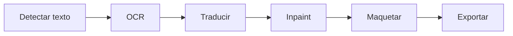

# Lumina — Ilumina cada historia

**Idiomas:** [English](README.md) | [Español](README.es.md)

Lumina es una aplicación de escritorio gratuita y de código abierto para traducir manga, manhwa y manhua. Automatiza el flujo completo — detección de texto, OCR, traducción, inpainting y maquetación — manteniendo editable cada etapa. Todos los modelos se ejecutan localmente con ONNX Runtime; la traducción es el único paso que utiliza APIs externas de IA.

Consulta el [sitio de documentación](https://lumina.navierr.dev/) para ver las guías y obtener más detalles.


## Índice

- [Funciones](#funciones)
- [Muestras](#muestras)
- [Cómo funciona](#cómo-funciona)
- [Arquitectura](#arquitectura)
- [Modelos](#modelos)
- [Traducción](#traducción)
- [Aceleración por GPU](#aceleración-por-gpu)
- [Instaladores y paquetes](#instaladores-y-paquetes)
- [Formato de proyecto (.lmi)](#formato-de-proyecto-lmi)
- [Desarrollo](#desarrollo)
- [Hoja de ruta](#hoja-de-ruta)
- [Registro de cambios](#registro-de-cambios)
- [Licencia](#licencia)

## Funciones

- **Pipeline semiautomático** — detección, OCR, traducción, inpainting y maquetación automatizados con controles flotantes, selector de presets (*Pipeline completo* / *Solo limpieza*) y progreso continuo.
- **Control manual completo** — reordenar y cambiar el tamaño de los cuadros detectados, volver a traducir líneas con el contexto del diálogo, editar o eliminar máscaras de inpainting y cancelar ediciones de texto con Escape.
- **Texto enriquecido y tipografía** — formato por caracteres (varios colores y fuentes, peso y cursiva), barra de formato flotante, editor alineado con la inclinación del texto y ajuste automático del tamaño.
- **Mercado de fuentes y recomendaciones** — catálogo integrado con 47 fuentes manga seleccionadas (diálogo, gritos, susurros y efectos de sonido) y búsqueda de más de 1.960 fuentes de Google, con instalación en Lumina o en el sistema para Windows y Linux y vista previa inmediata.
- **Inpainting consciente del contenido** — máscaras por instancia de texto y segmentación binaria de todo el texto de la página (`rfdetr_seg`).
- **Herramientas de selección** — lazo y rectángulo, selección múltiple (Mayús para añadir, Alt para quitar), controles de transformación y acciones rápidas para limpiar áreas o borrar máscaras.
- **Exportación flexible** — páginas a PNG, JPG, PDF multipágina o archivos Photoshop (PSD) con mesas de trabajo de texto editables.
- **Monitor de recursos** — estado de CPU, RAM, VRAM de GPU mediante NVML, modelos activos y descarga automática de modelos según presión de memoria.
- **Traducción contextual** — diálogo de toda la página y continuidad entre páginas de un capítulo.
- **Compatibilidad multiplataforma** — soporte nativo para Windows y Linux con detección automática de Wayland y X11.
- **Formato único de proyecto (.lmi)** — archivo ZIP que incluye páginas, detecciones, capas de texto enriquecido y máscaras.
- **Aceleración por GPU** — ONNX Runtime optimizado con NVIDIA CUDA 12 y proveedores DirectML universales.

## Muestras

Los ejemplos siguientes pueden no actualizarse con frecuencia y podrían no representar el resultado exacto de la versión actual de la rama principal.

<table>
  <thead>
    <tr>
      <th align="center" width="50%">Imagen original</th>
      <th align="center" width="50%">Imagen traducida</th>
    </tr>
  </thead>
  <tbody>
    <tr>
      <td align="center" width="50%">
        <a href="showcase/1/before.png"></a><br />
        <a href="https://x.com/rikak/status/1642727617886556160/photo/1">(Fuente: @rikak)</a>
      </td>
      <td align="center" width="50%">
        <a href="showcase/1/after.png"></a><br />
        <code>pipeline completo</code>
      </td>
    </tr>
    <tr>
      <td align="center" width="50%">
        <a href="showcase/2/before.jpg"></a><br />
        <a href="https://mangadex.org/title/d313c527-5a37-411f-b82b-3ca61feca13e">(Fuente: MangaDex)</a>
      </td>
      <td align="center" width="50%">
        <a href="showcase/2/after.png"></a><br />
        <code>pipeline completo</code>
      </td>
    </tr>
    <tr>
      <td align="center" width="50%">
        <a href="showcase/3/before.png"></a><br />
        <a href="https://x.com/hiduki_yayoi/status/1645186427712573440/photo/2">(Fuente: @hiduki_yayoi)</a>
      </td>
      <td align="center" width="50%">
        <a href="showcase/3/cleaned.png"></a><br />
        <code>solo inpainting — sin maquetación</code>
      </td>
    </tr>
  </tbody>
</table>

## Cómo funciona



Cada etapa produce resultados editables: los cuadros detectados pueden reordenarse o corregirse manualmente, el texto OCR puede editarse o traducirse nuevamente por línea y las máscaras de inpainting son capas individuales que pueden mostrarse, ocultarse, mover o eliminar antes de la exportación final.

## Arquitectura

- **Shell de Electron** — tres capas: `src/main/` (proceso Node: ventana, ciclo de vida del backend y archivos), `src/preload.ts` (puente aislado por contexto) y `src/renderer/` (interfaz, canvas y coordinación del pipeline).
- **Backend de Python** — servidor FastAPI en `localhost:8765`, iniciado y detenido por el proceso principal de Electron. Todas las inferencias y llamadas de traducción pasan por su API HTTP.
- **ONNX Runtime** — todos los modelos se ejecutan localmente como grafos ONNX; el backend selecciona el proveedor de ejecución en tiempo real.
- **Contrato IPC único** — `src/shared/bridge.ts` define todos los canales, cargas útiles y tipos compartidos entre procesos.

```text
lumina/
├── src/
│   ├── main/          Proceso principal de Electron (ventana, backend, mercado de fuentes y exportación)
│   ├── preload.ts     Puente IPC aislado
│   ├── renderer/      Interfaz, canvas, pipeline y mercado de fuentes
│   └── shared/        Contrato IPC compartido
├── python/
│   ├── main.py        Punto de entrada de FastAPI
│   ├── services/      Registros de modelos (detect / ocr / inpaint / translate)
│   └── prompts/       Instrucciones predeterminadas de traducción
├── models/            Modelos para desarrollo local (consulta Modelos)
└── cache/             Caché de ejecución y proyectos extraídos
```

## Modelos

Los modelos se administran en Ajustes → Modelos. No se incluyen con la aplicación; se descargan bajo demanda o se colocan manualmente en el directorio de modelos.

El directorio de modelos se determina en este orden: variable `LUMINA_MODEL_DIR`, ubicación guardada en Ajustes → Modelos (tarjeta «Directorio de modelos») o `userData/models` según el sistema (`%APPDATA%\Lumina\models` en Windows y `~/.config/lumina/models` en Linux). En una copia del código, define `LUMINA_MODEL_DIR` en `.env` (consulta [.env.example](.env.example)) para usar la carpeta `models/` del repositorio.

| Categoría | Modelo | Estado | Ejecución | Notas |
| -------- | ------ | ------ | --------- | ----- |
| Detectar | `rtdetr` | Listo (predeterminado) | CUDA / DirectML / CPU | Detector RT-DETR v2 r50vd para texto de cómics |
| Detectar | `rfdetr_seg` | Listo | CUDA / DirectML / CPU | Koharu Layout RF-DETR Seg 2XL (FP16) |
| OCR | `manga_ocr` | Listo (predeterminado) | CUDA / DirectML (decodificador en CPU) | Reconocedor japonés rápido y preciso |
| OCR | `baberu` | Listo | CUDA / DirectML (decodificador en CPU) | OCR manga multilingüe v1.2 (bocadillo de 256 caracteres) |
| OCR | `ppocrv6` | Listo | CUDA / DirectML / CPU | Lector rápido de líneas en varios idiomas |
| OCR | `paddleocr_vl` | En desarrollo | CUDA o CPU (sin DirectML) | Lector regional de visión-lenguaje |
| Inpaint | `lama_manga` | Listo (predeterminado) | CUDA o CPU (sin DirectML) | Inpainter especializado en manga y resolución preservada |
| Inpaint | `lama` | Listo | Solo CPU | Alternativa LaMa estándar |
| Auxiliar | `anglenet` | Listo (auxiliar) | Solo CPU | Mide automáticamente la inclinación del texto (~2 MB) |

«Listo» indica modelos establecidos; «En desarrollo» indica modelos funcionales que pueden presentar casos límite.

Los modelos pueden instalarse o eliminarse desde Ajustes → Modelos. La memoria se administra mediante consultas NVML/Win32 con descarga automática LRU al superar el 80 % de uso.

`anglenet` es un modelo auxiliar pequeño (~2 MB) que Lumina descarga automáticamente al iniciar por primera vez. Mide la inclinación de cada cuadro de texto para rotar la traducción y adaptar el aspecto del original (`textAngle`); si no existe, usa el método heurístico PCA.

## Traducción

La traducción es el único paso que llama a una API externa de IA. Detección, OCR, inpainting y maquetación funcionan completamente sin conexión. El usuario elige un proveedor e introduce su clave API en Ajustes; la clave no sale del equipo salvo como encabezado de una solicitud directa al proveedor elegido. Todos los endpoints compatibles con OpenAI (Ollama, LM Studio, vLLM, etc.) y los principales modelos comerciales son compatibles mediante un prompt neutral para localización de cómics (`prompts/translate-default.md`).

| Proveedor | Compatible con | Notas |
| --------- | -------------- | ----- |
| Personalizado | Cualquier API compatible con OpenAI | Introduce tu URL base (Ollama, LM Studio, vLLM, etc.) y el nombre del modelo |
| OpenRouter | OpenRouter | Utiliza tu clave y modelo de OpenRouter |
| xAI / Groq | Groq (GroqCloud) / xAI Grok | Utiliza tu clave y modelo de Groq o xAI |
| Gemini | Google Gemini | Utiliza tu clave API de Gemini |

- **Las claves API permanecen locales y cifradas.** Se guardan en la bóveda local de Lumina, cifrada mediante DPAPI en Windows, Keychain en macOS o libsecret en Linux. Se mantienen en `secrets.json` dentro de la carpeta de datos del usuario y nunca se escriben en proyectos `.lmi`. Solo se envían al proveedor configurado. Si el cifrado del sistema no está disponible, se usa una codificación base64 como alternativa.
- **Los proveedores se cargan bajo demanda.** Lumina solo importa el SDK del proveedor usado, sin costo de inicio por los demás proveedores o modelos locales.

## Aceleración por GPU

Lumina utiliza ONNX Runtime con soporte GPU cuando está disponible.

- **Un proveedor de ejecución por entorno.** Las ruedas DirectML y CUDA no pueden coexistir en el mismo entorno Python. Se distribuyen dos instaladores: DirectML universal y CUDA exclusivo para NVIDIA (consulta [Instaladores](#instaladores)).
- **La variable `LUMINA_EP`** reemplaza la preferencia de ejecución: `auto` (CUDA → DirectML → CPU, según las ruedas disponibles), `cuda` (CUDA y luego CPU, nunca DirectML), `dml` o `cpu`.
- **Las preferencias por modelo** se incluyen en la configuración. Algunos modelos no admiten determinados proveedores: `lama` solo usa CPU, `lama_manga` y `paddleocr_vl` nunca usan DirectML y varios modelos OCR mantienen el decodificador autorregresivo en CPU.

## Instaladores y paquetes

Los instaladores y paquetes se publican en la página de [releases](https://github.com/lumina-tl/lumina/releases):

### Windows

- **`Lumina-Setup-DML-<version>.exe`** — DirectML universal: funciona con GPU compatibles con DirectX 12 (AMD, Intel y NVIDIA) y usa CPU si no hay compatibilidad.
- **`Lumina-Setup-CUDA-<version>.exe`** — NVIDIA CUDA 12: recomendado para tarjetas NVIDIA RTX/GTX por su mayor velocidad de inferencia.

Ambos instaladores admiten actualizaciones diferenciales mediante sus canales `dml` o `cuda`.

### Linux

- **`Lumina-CPU-<version>-linux-x86_64.AppImage`** — AppImage universal con ONNX Runtime CPU.
- **`Lumina-CUDA-<version>-linux-x86_64.AppImage`** — AppImage NVIDIA CUDA 12 para sistemas Linux con controladores NVIDIA propietarios.

Los paquetes de Linux admiten Wayland y X11. Para integrarlos en el entorno de escritorio, ejecuta:

```sh
bash scripts/install-linux-appimage.sh /ruta/Lumina-*.AppImage
```

> **Runtime CUDA bajo demanda:** los paquetes CUDA no incluyen directamente las bibliotecas ONNX Runtime y NVIDIA (~1,4 GB). Lumina descarga y verifica una vez el archivo correspondiente (`cuda-runtime-win.7z` o `cuda-runtime-linux.tar.gz`) en los datos de usuario. Así, la descarga inicial se mantiene pequeña (~120 MB) y las actualizaciones diferenciales no vuelven a descargar los pesos CUDA.

Al ejecutar desde el código fuente, instala `onnxruntime-directml` para GPU universal o `onnxruntime-gpu[cuda,cudnn]` para NVIDIA CUDA (consulta [Desarrollo](#desarrollo)) y ejecuta `npm run dev`.

## Formato de proyecto (.lmi)

Un `.lmi` es un archivo ZIP que contiene `project.json`, las imágenes de las páginas y las máscaras de inpainting. El manifiesto guarda el orden, detecciones, spans de texto enriquecido, capas, tipografía y ajustes de traducción no secretos. Las claves API nunca se almacenan en el proyecto.

## Desarrollo

### Requisitos previos

- Node.js v22 o superior, para Electron, esbuild y TypeScript.
- Python 3.13 en Windows o Python 3.12 en Linux.
- Un proveedor GPU, si se desea acelerar la ejecución:
  - NVIDIA: controlador con CUDA y rueda `onnxruntime-gpu[cuda,cudnn]`.
  - Otros sistemas: rueda `onnxruntime-directml` o CPU.
- Archivos de modelos en el directorio configurado o descargados desde Ajustes → Modelos.

### Configuración

```sh
python -m venv venv
venv\Scripts\pip install -r python\requirements.txt   # Windows
# source venv/bin/activate && pip install -r python/requirements.txt  # macOS/Linux

npm install
npm run build
npm run dev

npm run dist:dml
npm run dist:cuda
npm run dist:linux
npm run dist:linux:cuda
```

Electron inicia el backend automáticamente; no es necesario ejecutar un servidor independiente.

## Hoja de ruta

Consulta [TODO.md](TODO.md) para ver los problemas conocidos y el trabajo previsto.

## Registro de cambios

Consulta [CHANGELOG.md](CHANGELOG.md) para conocer el historial de versiones de Lumina.

## Licencia

Lumina se distribuye bajo la [Licencia MIT](LICENSE). Esta licencia cubre únicamente el código fuente y el paquete de la aplicación.

Los archivos de modelos **no** están incluidos en la distribución y **no** están cubiertos por esta licencia. Se descargan por separado y cada modelo conserva sus propios términos de licencia.

El detector predeterminado `rtdetr` tiene licencia Apache-2.0. El detector de segmentación `rfdetr_seg` (Koharu Layout RF-DETR Seg 2XL) fue entrenado con el conjunto de datos [Manga109](https://manga109.github.io/manga109-project-website/en/) y está restringido a investigación académica y no comercial; se ofrece únicamente como modelo opcional con ese fin.
