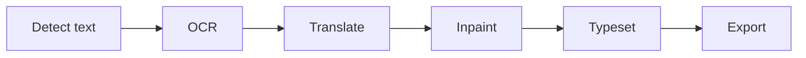

# Lumina — Illuminate every story

Lumina is a free, open-source desktop app for translating manga, manhwa, and manhua. It automates the full pipeline — text detection, OCR, translation, inpainting, and typesetting — while keeping every step editable. All models run locally on ONNX Runtime; translation is the only step that calls external AI APIs.

See the [documentation website](https://lumina.navierr.dev/) for guides and details.


## Table of Contents

- [Features](#features)
- [Showcase](#showcase)
- [How It Works](#how-it-works)
- [Architecture](#architecture)
- [Models](#models)
- [Translation](#translation)
- [GPU Acceleration](#gpu-acceleration)
- [Installers & Packages](#installers--packages)
- [Project File Format (.lmi)](#project-file-format-lmi)
- [Development](#development)
- [Roadmap](#roadmap)
- [Changelog](#changelog)
- [License](#license)

## Features

- **Semi-automatic pipeline** — automated detection, OCR, translation, inpainting, and typesetting with floating pipeline controls, preset switcher (*Full Pipeline* / *Clean Only*), and real-time streaming progress.
- **Full manual control** — re-order/resize detected boxes, re-translate lines with surrounding dialogue context, edit or remove inpaint masks, and cancel in-place text edits with Escape.
- **Rich text & typography** — character-level formatting (multi-color, multi-font, weight, italic), floating formatting toolbar, rotated in-place editor matching text slant, and auto-fit sizing.
- **Font Market & Recommendations** — built-in catalog with 47 curated manga fonts (Dialogue, Scream, Whisper, SFX) and live search across 1,960+ Google Fonts, supporting one-click in-app or system user-space installation (Windows and Linux) with instant glyph preview.
- **Content-aware inpainting** — text-instance masking plus full-page binary text segmentation (`rfdetr_seg`).
- **Selection tools** — lasso and rectangle with multi-selection (Shift add, Alt subtract), transform controls, and quick actions (clean area / erase masks).
- **Flexible export** — export pages to PNG, JPG, multi-page PDF documents, or layered Photoshop (PSD) files with editable text artboards.
- **Hardware resource monitor** — real-time status bar monitor for CPU, RAM, GPU VRAM (via NVML), active models, and automatic memory-pressure LRU eviction.
- **Context-aware translation** — whole-page dialogue awareness and cross-page context continuity across chapter transitions.
- **Cross-platform desktop support** — native support for Windows and Linux with Wayland and X11 auto-detection.
- **Single project format (.lmi)** — zip-packaged project files bundling pages, detection data, rich text layers, and mask patches.
- **GPU acceleration** — optimized ONNX Runtime execution with NVIDIA CUDA 12 and universal DirectML providers.

## Showcase

The following examples may not be frequently updated and may not represent the effect of the current main branch version.

<table>
  <thead>
    <tr>
      <th align="center" width="50%">Original Image</th>
      <th align="center" width="50%">Translated Image</th>
    </tr>
  </thead>
  <tbody>
    <tr>
      <td align="center" width="50%">
        <a href="showcase/1/before.png">
          
        </a>
        <br />
        <a href="https://x.com/rikak/status/1642727617886556160/photo/1">(Source @rikak)</a>
      </td>
      <td align="center" width="50%">
        <a href="showcase/1/after.png">
          
        </a>
        <br />
        <code>full pipeline</code>
      </td>
    </tr>
    <tr>
      <td align="center" width="50%">
        <a href="showcase/2/before.jpg">
          
        </a>
        <br />
        <a href="https://mangadex.org/title/d313c527-5a37-411f-b82b-3ca61feca13e">(Source: MangaDex)</a>
      </td>
      <td align="center" width="50%">
        <a href="showcase/2/after.png">
          
        </a>
        <br />
        <code>full pipeline</code>
      </td>
    </tr>
    <tr>
      <td align="center" width="50%">
        <a href="showcase/3/before.png">
          
        </a>
        <br />
        <a href="https://x.com/hiduki_yayoi/status/1645186427712573440/photo/2">(Source @hiduki_yayoi)</a>
      </td>
      <td align="center" width="50%">
        <a href="showcase/3/cleaned.png">
          
        </a>
        <br />
        <code>inpaint only — no typesetting</code>
      </td>
    </tr>
  </tbody>
</table>

## How It Works



Each step produces editable results: detected boxes can be re-ordered or corrected by hand, OCR text can be edited or retranslated per line, and inpaint masks are individual layers you can toggle, move, or remove before final export.

## Architecture

- **Electron shell** — three layers: `src/main/` (Node process: window, backend lifecycle, file I/O), `src/preload.ts` (context-isolated bridge), `src/renderer/` (UI, canvas, pipeline orchestration).
- **Python backend** — a FastAPI server on `localhost:8765`, spawned and stopped by the Electron main process. All model inference and translation calls go through its HTTP API.
- **ONNX Runtime** — every model runs locally as an ONNX graph; the backend resolves the execution provider at runtime.
- **Single IPC contract** — `src/shared/bridge.ts` defines every channel, payload, and shared type used across processes.

```
lumina/
├── src/
│   ├── main/          Electron main process (window, backend, font-market, export)
│   ├── preload.ts     Context-isolated IPC bridge
│   ├── renderer/      UI, canvas, pipeline orchestration, font market
│   └── shared/        IPC contract shared with both processes
├── python/
│   ├── main.py        FastAPI entry point
│   ├── services/      Pluggable model registries (detect / ocr / inpaint / translate)
│   └── prompts/       Default translation instructions
├── models/            Model files for local development (see Models section)
└── cache/             Runtime cache (patches, extracted projects)
```

## Models

Models are managed in Settings → Models. They are not bundled with the app; each one is downloaded on demand or placed manually in a models directory.

The models directory is resolved in this order: the `LUMINA_MODEL_DIR` environment variable, the location saved in Settings → Models (via the “Models directory” card), or the platform default `userData/models` (`%APPDATA%\Lumina\models` on Windows, `~/.config/lumina/models` on Linux). In a source checkout, set `LUMINA_MODEL_DIR` in `.env` (see [.env.example](.env.example)) to keep using the repo's `models/` folder.

| Category | Model          | Status          | Execution                        | Notes                                          |
| -------- | -------------- | --------------- | -------------------------------- | ---------------------------------------------- |
| Detect   | `rtdetr`       | Ready (default) | CUDA / DirectML / CPU            | RT-DETR v2 r50vd comic text detector           |
| Detect   | `rfdetr_seg`   | Ready           | CUDA / DirectML / CPU            | Koharu Layout RF-DETR Seg 2XL (FP16)  |
| OCR      | `manga_ocr`    | Ready (default) | CUDA / DirectML (decoder on CPU) | Fast, accurate Japanese recognizer             |
| OCR      | `baberu`       | Ready           | CUDA / DirectML (decoder on CPU) | Multilingual manga OCR v1.2 (256-token bubble) |
| OCR      | `ppocrv6`      | Ready           | CUDA / DirectML / CPU            | Fast multi-language text line reader           |
| OCR      | `paddleocr_vl` | In development  | CUDA or CPU (no DirectML)        | Vision-language region reader                  |
| Inpaint  | `lama_manga`   | Ready (default) | CUDA or CPU (no DirectML)        | Manga-tailored resolution-preserving inpainter |
| Inpaint  | `lama`         | Ready           | CPU only                         | Standard LaMa fallback                         |
| Aux      | `anglenet`     | Ready (aux)     | CPU (forced)                     | Auto-measures bubble slant angle (~2 MB)       |

"Ready" models are stable; "In development" models work but may still have rough edges.

Models can be installed or deleted from disk anytime in Settings → Models. Memory is managed dynamically via native NVML/Win32 queries with automatic LRU eviction above 80% usage threshold.

`anglenet` is a tiny global model (~2 MB) that the app auto-downloads in the background on first launch (it also shows up in the model check endpoint, so it can be fetched again manually if needed). It measures the slant of each detected text crop so typesetting can rotate translated text to match the original (`textAngle`); if the file is missing, slant falls back to the PCA heuristic.

## Translation

Translation is the only step that calls an external AI API — everything else (detection, OCR, inpainting, typesetting) runs fully offline. You pick a provider and enter its API key in the translation settings; the key never leaves your machine except as a request header sent directly to the provider you chose. All OpenAI-compatible endpoints (Ollama, LM Studio, vLLM, etc.) and major commercial LLMs are supported via a neutral comic localization prompt (`prompts/translate-default.md`).

| Provider   | Compatible with                         | Notes                                                                                                                                            |
| ---------- | --------------------------------------- | ------------------------------------------------------------------------------------------------------------------------------------------------ |
| Custom     | Any OpenAI-compatible API               | Bring your own base URL (Ollama, LM Studio, vLLM, local inference, etc.) and model name                                                         |
| OpenRouter | OpenRouter                              | Uses your OpenRouter key and model                                                                                                               |
| xAI / Groq | Groq (GroqCloud) / xAI Grok             | Uses your Groq or xAI API key and model                                                                                                          |
| Gemini     | Google Gemini                           | Uses your Gemini API key                                                                                                                         |

- **API keys stay local and encrypted.** Keys are stored in Lumina's local secrets vault — encrypted with your operating system's credential facility (DPAPI on Windows, Keychain on macOS, libsecret on Linux) and persisted to `secrets.json` in the app's user-data folder. They are never written to project files (`.lmi`) or sent anywhere except directly to the provider you configured. If the OS encryption facility is unavailable, a fallback (base64 obfuscation) is used rather than failing.
- **Providers load on demand.** The app only imports the SDK for the provider you actually use, so switching between providers (or running local-only models) has no startup cost for the others.

## GPU Acceleration

Lumina uses ONNX Runtime with GPU support where available.

- **One execution provider per environment.** The DirectML and CUDA wheels cannot coexist in a single Python environment. Two installers ship, one per provider: the universal DirectML installer and the NVIDIA-only CUDA installer (see [Installers](#installers)).
- **`LUMINA_EP` environment variable** overrides the runtime preference: `auto` (CUDA → DirectML → CPU, falling back per wheel), `cuda` (CUDA, falling back to CPU — never DirectML), `dml`, or `cpu`.
- **Per-model preferences** are baked into each model's configuration. Some models cannot run on certain providers: `lama` is CPU-only (GPU acceleration is ignored when enabled), `lama_manga` and `paddleocr_vl` never use DirectML (CUDA when available, otherwise CPU), and some OCR models keep their autoregressive decoder on CPU regardless of the chosen provider.

## Installers & Packages

Installers and packages are published on the [Releases](https://github.com/lumina-tl/lumina/releases) page:

### Windows

- **`Lumina-Setup-DML-<version>.exe`** — DirectML (universal): runs on any DirectX 12 GPU (AMD, Intel, NVIDIA) and falls back to CPU on machines without a compatible GPU.
- **`Lumina-Setup-CUDA-<version>.exe`** — NVIDIA CUDA 12: **highly recommended over the DML installer if you have an NVIDIA RTX/GTX card** for significantly faster inference.

Both Windows installers feature differential auto-updates on launch via their respective update channels (`dml` or `cuda`).

### Linux

- **`Lumina-CPU-<version>-linux-x86_64.AppImage`** — Universal Linux AppImage using ONNX Runtime CPU.
- **`Lumina-CUDA-<version>-linux-x86_64.AppImage`** — NVIDIA CUDA 12 AppImage for Linux systems with proprietary NVIDIA drivers.

Both Linux packages support Wayland and X11 out of the box. To integrate the AppImage into your desktop environment (launcher shortcuts, icons, and `.lmi` file associations), run:

```sh
bash scripts/install-linux-appimage.sh /path/to/Lumina-*.AppImage
```

> **CUDA on-demand runtime:** CUDA packages (Windows installer and Linux AppImage) do not bundle the ~1.4 GB ONNX Runtime and NVIDIA libraries directly. Instead, the app downloads and verifies the platform runtime archive (`cuda-runtime-win.7z` or `cuda-runtime-linux.tar.gz`) once into user data on first launch. This keeps initial downloads small (~120 MB) and ensures subsequent application updates stay fast and differential without re-downloading CUDA weights.

When running from source, pick the provider wheel yourself: `onnxruntime-directml` for universal GPU support, or `onnxruntime-gpu[cuda,cudnn]` for NVIDIA CUDA (see [Development](#development)), then start the app with `npm run dev`.

## Project File Format (.lmi)

A `.lmi` file is a zip archive containing a `project.json` manifest plus page images and inpaint mask patches. The manifest stores page order, text detections, rich text spans, layers, typography, and non-secret translation settings. API keys are never stored in the project file.

## Development

### Prerequisites

- Node.js v22+ (for Electron, esbuild, TypeScript)
- Python 3.13 (Windows) or Python 3.12 (Linux)
- A GPU execution provider, if GPU acceleration is wanted:
  - NVIDIA: CUDA-enabled driver plus the `onnxruntime-gpu[cuda,cudnn]` wheel
  - Otherwise: the `onnxruntime-directml` wheel (any GPU) or plain CPU
- Model files placed in the models directory (or downloaded through Settings → Models once the app runs)

### Setup

```sh
# Python backend
python -m venv venv
venv\Scripts\pip install -r python\requirements.txt   # Windows
# source venv/bin/activate && pip install -r python/requirements.txt  # macOS/Linux

# Frontend
npm install
npm run build

# Run in dev mode
npm run dev

# Package binaries
npm run dist:dml          # Windows DML installer
npm run dist:cuda         # Windows CUDA installer
npm run dist:linux        # Linux CPU AppImage
npm run dist:linux:cuda   # Linux CUDA AppImage
```

The backend is started automatically by the Electron main process; no separate server setup is needed.

## Roadmap

See [TODO.md](TODO.md) for the current list of known issues and planned work.

## Changelog

See [CHANGELOG.md](CHANGELOG.md) for the release history of Lumina.

## License

Lumina is released under the [MIT License](LICENSE). This license covers the source code and the application bundle only.

Model files are **not** included in the distribution and are **not** covered by this license. They are downloaded separately (via the app or manually), and each model carries its own license terms.

The default detector, `rtdetr`, is Apache-2.0 licensed. The segmentation detector `rfdetr_seg` (Koharu Layout RF-DETR Seg 2XL) is trained on the [Manga109](https://manga109.github.io/manga109-project-website/en/) dataset and is restricted to academic, non-commercial research use; it is offered as an optional model for that purpose only.
